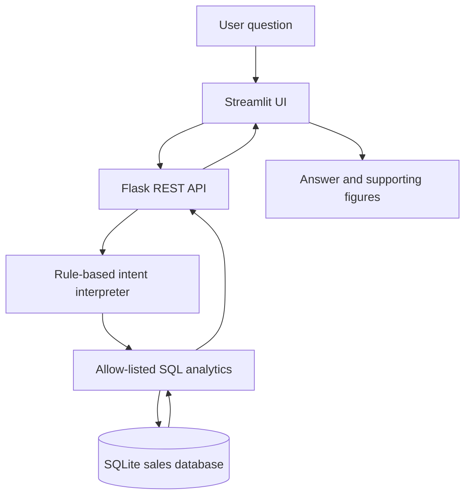

# Mini AI Business Intelligence Assistant

A small Python application that answers natural-language questions about the supplied sales CSV using a Flask API, SQLite, Pandas, and Streamlit.

## Important implementation note

No paid LLM API key is required for this version. The question interpreter is a transparent, rule-based natural-language intent mapper. It maps supported question patterns to a small set of predefined analytics operations. This is **not an LLM**, and the project does not claim otherwise. It is a lightweight fallback that keeps the application runnable without external credentials. A future improvement is to add an LLM provider (for example, an API-backed model or a locally hosted model) that maps questions to the same allow-listed intents.

## Features

- Imports the provided CSV into SQLite.
- Excludes returned transactions, missing required values, invalid numeric values, and non-positive quantities.
- Calculates revenue as `quantity * unit_price - discount_amount`.
- Supports total revenue, highest-revenue product, monthly trend, highest-revenue region, and comparison between two named months.
- Returns structured JSON with supporting figures.
- Uses predefined, read-only SQL queries; user text is never executed as SQL.
- Includes a Streamlit interface and automated tests.

## Data-cleaning policy

The dataset contains 51 rows. The application includes only rows whose status is `Completed`, whose required fields are valid, and whose quantity is positive. Returned rows are excluded. Rows with missing required values (such as the missing unit price) are excluded. Revenue is calculated per row before aggregation.

With the supplied CSV, this policy imports 48 rows and calculates total revenue of **₹14,39,200.00**. This figure is a useful validation check; the application calculates it from the CSV at startup.

## Requirements

- Python 3.10+
- pip

## Setup on Ubuntu

From the extracted project directory:

```bash
python3 -m venv .venv
source .venv/bin/activate
pip install -r requirements.txt
```

## Run the backend

Open terminal 1:

```bash
source .venv/bin/activate
python -m backend.app
```

The API starts at `http://127.0.0.1:5000`.

Check it:

```bash
curl http://127.0.0.1:5000/api/health
```

## Run the frontend

Open terminal 2 in the same project directory:

```bash
source .venv/bin/activate
streamlit run frontend/dashboard.py
```

Streamlit will show a local URL, usually `http://localhost:8501`.

## Ask the API directly

```bash
curl -X POST http://127.0.0.1:5000/api/ask \
  -H "Content-Type: application/json" \
  -d '{"question":"What is the total revenue?"}'
```

## Supported example questions

- What is the total revenue?
- Which product generated the highest revenue?
- What is the monthly revenue trend?
- Which region generated the highest sales?
- How did revenue change between January and February?

Month comparisons work for two month names present in the dataset.

## Run tests

```bash
pytest -q
```

The test suite covers supported questions, unsupported questions, invalid requests, and data-cleaning edge cases.

## Architecture



## API

### `GET /api/health`
Returns API status.

### `GET /api/summary`
Returns the number of imported valid transactions and total revenue.

### `POST /api/ask`
Request body:

```json
{"question": "Which product generated the highest revenue?"}
```

Response includes the interpreted intent, answer, and supporting data.

## Limitations and future improvements

- The no-key interpreter recognizes a defined set of question patterns; it does not understand every possible phrasing.
- There is no external LLM integration in this version.
- The data is a small sample dataset, not a live business database.
- Month comparison expects month names and compares the first two matching month names in the question.
- For production, add authentication, logging, stronger validation, and an LLM provider with strict tool/intent validation.
